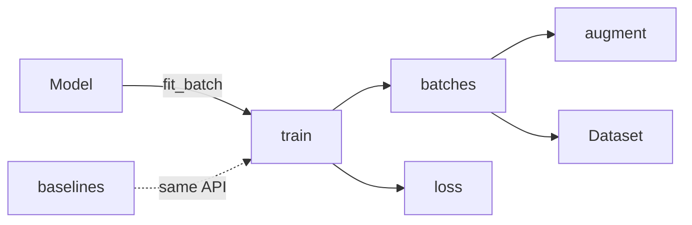

# Architecture Example: a single-package proof of concept

More: `examples-new-multi.md` (a multi-package platform with System pipelines).

## Single Package — LeafLab Training Loop (Proof of Concept)

**Context:** The spec describes a small image-classification lab where a model learns to tell plant-leaf diseases apart on a clean single-crop leaf set, trying to beat a majority-class and a logistic baseline. Requirements include `TRN-01`–`TRN-05` (batches, augmentation, model update, loss, run end), `BASE-01` (majority-class and logistic baselines), `DATA-01`–`DATA-02` (leaf images and labels), `QR-01` (≥ 500 images/second through training on a laptop CPU), and `QR-02` (same seed → identical run).

**Step 1 — Shape:** "Single package. It's a proof of concept with one user, one install, and no separate deployments. I'll keep the image loader behind an interface so it can become its own package if this grows."

**Step 4 — Decisions the skill asked the user about:** PyTorch vs. NumPy-only models (affects whether a CNN's backward pass is ours to write), and synthetic vs. real leaf images for the first version.

**Result — `docs/architecture.md`:**

````markdown
# LeafLab — Architecture

**Status:** Draft · **Shape:** Single package · **Last updated:** 2026-10-14 · **Spec:** [spec.md](spec.md)

## Overview
A model trains on batches of leaf images for a fixed number of epochs. Each batch, the batches module draws the next images from the dataset and augments them. The loss is class-weighted cross-entropy. Images come from a `Dataset`: synthetic first, the single-crop leaf set second.



## Tech stack
| Area | Choice | Decision |
|---|---|---|
| Language | Python 3.12 | AD-01 |
| Models | PyTorch ≥ 2.4, CPU wheels | AD-02 |
| Numerics | NumPy ≥ 2.0 | AD-03 |
| Storage | Image folders plus a Parquet label index via PyArrow | AD-04 |
| Tests | pytest | — |

## Components
| Component | Responsibility | Covers | Depends on |
|---|---|---|---|
| `train` | Training loop: epochs, batches, checkpoints, run end | TRN-01, TRN-03, TRN-05, QR-02 | `batches`, `loss` |
| `batches` | Draws the next batch from the dataset and augments it | TRN-02 | `augment`, `core` |
| `augment` | Image augmentation (flips, crops, colour jitter) | TRN-02 | — |
| `loss` | Class-weighted cross-entropy | TRN-04 | — |
| `core` | `Dataset` and `Model` protocols; synthetic and folder datasets | DATA-01, DATA-02 | — |
| `baselines` | Majority-class and logistic models behind the same `Model` protocol | BASE-01 | `train` |

## Interfaces
See [packages/leaflab/contract.md](packages/leaflab/contract.md).

## Data
- `SyntheticSet`: coloured spots on a green disc, the class set by spot colour; used for the first experiments (AD-04).
- `FolderSet`: one folder of JPEG images per class, with a Parquet index `path, label, split`, written by `scripts/download_leaves.py` (DATA-01). Unreadable images are skipped and logged (DATA-02).

## Cross-cutting concerns
- **Speed (QR-01):** images are decoded once into a preallocated uint8 array; each batch is augmented with plain NumPy array math, no per-image PIL calls inside the loop. Benchmarked in `tests/test_speed.py`.
- **Reproducibility (QR-02):** one `np.random.Generator` and one `torch.Generator` per run, both created from the run seed and passed down; no global random state.

## Project layout
```
src/leaflab/      → train/ batches/ augment/ loss/ core/ baselines/ — one folder per component; __init__ exports its contract
scripts/          → leaf image download script (DATA-01)
tests/
```

## Decisions
### AD-01: Python 3.12
**Status:** Proposed · **Date:** 2026-10-14 · **Scope:** system
- **Context:** ML libraries and the user's existing tooling are Python.
- **Decision:** Python 3.12.
- **Alternatives:** 3.13 — some ML libraries lag on new versions.
- **Consequences:** Pin `requires-python = ">=3.12,<3.13"` until the libraries catch up.

### AD-02: PyTorch for models
**Status:** Proposed · **Date:** 2026-10-14 · **Scope:** system
- **Context:** Models start with logistic regression and move to a small CNN; we want standard layers and autograd without adapters.
- **Decision:** Every model is a `torch.nn.Module` behind `core.Model`.
- **Alternatives:** NumPy only — simpler, but the CNN's backward pass becomes the project. JAX — capable, less CPU tooling on a laptop.
- **Consequences:** Batches must be fixed-shape tensors. Multi-worker data loading comes for free.

### AD-03: Batched NumPy augmentation, not per-image PIL calls
**Status:** Proposed · **Date:** 2026-10-14 · **Scope:** system
- **Context:** QR-01 needs ≥ 500 images/second. Images are a fixed 128×128; no learned augmentation.
- **Decision:** Each batch is augmented as array math on a preallocated array.
- **Alternatives:** Per-image PIL transforms — richer, far too slow and partly out of scope (spec Out of scope: learned augmentation).
- **Consequences:** Augmentations are limited to what array math does well. Fine for a proof of concept; revisit if accuracy depends on it.

### AD-04: Synthetic images first, the leaf set second
**Status:** Proposed · **Date:** 2026-10-14 · **Scope:** data
- **Context:** DATA-01 needs the single-crop leaf set. A public sample covers three classes; the full set needs a licence request.
- **Decision:** Ship `SyntheticSet` first and add `FolderSet` from the public sample. Both behind `Dataset`.
- **Alternatives:** Request the full set now — premature before the training loop proves useful.
- **Consequences:** Early results are on synthetic images; the brief's success measure needs real leaves, so `FolderSet` must land before evaluation.

## Risks and open questions
- The synthetic generator's spot colours are guesses. Models may learn the generator's shortcut. Mitigation: compare against the logistic baseline under two different generator settings.

## Changelog
| Date | Change | Source | IDs |
|---|---|---|---|
| 2026-10-14 | Initial architecture | spec.md | AD-01–AD-04 |
````

**Result — `docs/packages/leaflab/contract.md`:**

````markdown
# leaflab — Contract

**Package:** leaflab · **Status:** Draft · **Last updated:** 2026-10-14 · **Architecture:** [../../architecture.md](../../architecture.md)

## train

### train.Trainer: Training loop
```python
class Trainer:
    def __init__(self, model: Model, dataset: Dataset, *, seed: int, epochs: int) -> None: ...
    def fit(self) -> RunLog: ...
```
- **Invariants:** each epoch visits every training image once, in fixed-size batches; stops after `epochs` or when validation loss hasn't improved for 3 epochs; same seed → identical run
- **Errors:** `ValueError` if `epochs` < 1
- **Used by:** baselines, any model

## core

### core.Dataset: Leaf image provider
`class Dataset(Protocol): def batches(self, rng: np.random.Generator, size: int) -> Iterator[Batch]`
- **Invariants:** deterministic for a given `rng` state; every image appears once per pass
- **Errors:** `FileNotFoundError` if the image folder is missing (folder dataset only)
- **Used by:** batches

### core.Batch: type
`@dataclass(frozen=True) class Batch: images: np.ndarray; labels: np.ndarray`
- **Invariants:** `images` is B×128×128×3 uint8; `labels` has B entries in `[0, n_classes)`
- **Boundary:** batches · **Fixtures:** tests/contracts/core.Batch/ · **Cases:** one 8-image synthetic batch
- **Used by:** batches

## loss

### loss.weighted_cross_entropy: Class-weighted loss
`def weighted_cross_entropy(logits: torch.Tensor, labels: torch.Tensor, weights: torch.Tensor) -> torch.Tensor`
- **Invariants:** a scalar ≥ 0; near 0 when every image gets probability 1 on its label; equal weights give plain cross-entropy
- **Errors:** `ValueError` if any weight is negative
- **Used by:** train
````

**About two pages plus a one-page contract.** No packages table, no dependency rules section, and no separate package docs. The seam that might become a package later (`Dataset`) is named and nothing more. Each component is a folder exporting only its contract section, so a later split moves `core/` and its `## core` group as they are. `Batch` passes from `core` to `batches`, so it is a `type` section with a `**Boundary:**` line: the build's interface task freezes it with one sample, and both components build against that sample at once (`Model` and `RunLog` are omitted here). `Used by` names components: the pipelines that use each symbol don't exist until `pipeline-design` runs.
