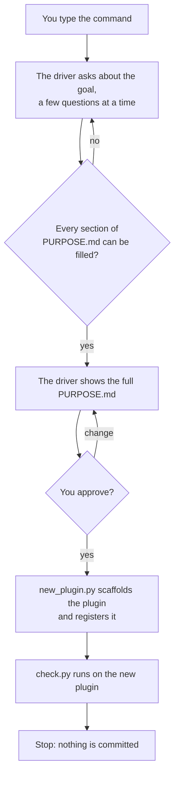

# Start a plugin

`/plugin-dev:new-plugin [plugin-name] [what it is for]`

| | |
|---|---|
| **Run it when** | you want a plugin that does not exist yet |
| **Run it in** | any chat inside the marketplace repo |
| **It leaves** | `{name}/` with an agreed `PURPOSE.md`, a manifest at 0.1.0, a README, a changelog, the site templates, and a row in `marketplace.json` |

## The flow

## Step by step

1. **Discuss the goal.** The driver is the main chat. It talks the plugin through with you
   until it can fill the five sections of the purpose: the goal, who uses it and when, what
   it does, the non-goals, and what done well means. It pushes back where an answer is
   vague, where two goals pull against each other, and where a non-goal contradicts
   something the plugin is meant to do. The name and a one-line description are settled
   here too.
2. **Agree the text.** The driver shows the whole `PURPOSE.md`, inside the purpose word
   limit, and revises it until you say it is right.
3. **Scaffold.** One command, `new_plugin.py`, copies the templates, writes the manifest
   and adds the marketplace row. No model writes those files.
4. **Check and stop.** `check.py` runs on the new plugin and its result is reported. No
   skill or agent is written in this chat.

## Why it is built this way

The discussion is the work. `PURPOSE.md` is printed into every later session that edits the
plugin, so a change that does not serve the goal is noticed before it is built. A plugin
that starts as files has nothing to be held to.

## Where it stops for you

- Each round of questions about the goal.
- The approval of the purpose text. Nothing is scaffolded before that yes.
- Committing the new plugin is yours to ask for.

## What comes next

Open a new session in `{name}/`, where the purpose is printed before the first edit, and
build its first skills there.
