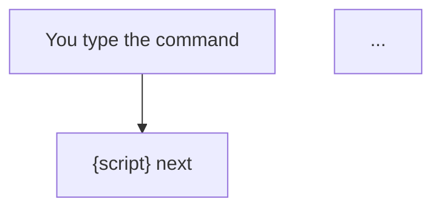

# A workflow page

Every workflow skill has one page, `site/workflows/{skill}.md`, written for a person who
wants to know what happens when they type the command and why it is built that way. It is
written by hand from the workflow skill, its agents and its script, and rewritten in the
same change as any of them. `check.py` fails a plugin whose workflow skill has no page.

The page explains. It does not repeat the skill's instructions to the driver: the skill's
own page on the site has those.

## The shape

````markdown
# {What the workflow does, as a verb phrase}

`/{plugin}:{skill} {arguments}`

| | |
|---|---|
| **Run it when** | {what is true before} |
| **Run it in** | {which chat, which directory} |
| **It leaves** | {the files it ends on, and their state} |

## The flow



## Step by step

1. **{Step}.** {Who does it: the driver, an agent by name, or the script. What it reads and
   writes. What is checked before the run moves on.}

## Why it is built this way

{What the design buys: what stays out of the driver's context, what code decides, what
makes steps independent.}

## Where it stops for you

- {Each question, approval or failure that waits for the user.}

## Picking it up again

{Where the run lives, and what typing the command again does.}

## What comes next

{The next command, linked to its page.}
````

## The rules

- **One chart of the loop**, drawn from the script's exit codes and the agents' returns,
  each branch labelled with the code or the word that takes it. Add a second, smaller chart
  only for something that repeats inside the loop, such as the stages of a phase.
- **Name the actor of every step.** A step with no agent says so.
- **Say what is checked, and by what.** A check a script makes is named as the script's.
- **Every stop for the user is listed.** A stop missing from the list is a stop the reader
  will not expect.
- **Link, do not restate.** Another workflow is a link to its page. A document's format is
  a link to the reference that owns it.
- Leave out a heading that has nothing under it, such as **Picking it up again** for a
  workflow that runs in one pass.
- List the pages in `workflows_order` in `site/site.yml`, in the order they are run, and
  give each a row in the **Which route** table of `site/flow.md`.
