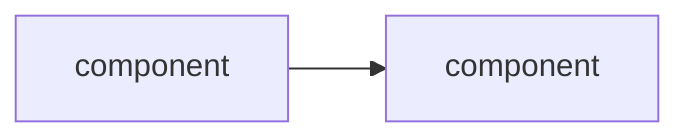

# Architecture Design

## Overview

The brief says **why**, the spec says **what**, and the architecture (`docs/architecture.md`) says **how it will be built**: the components, how they depend on each other, the interfaces between them, and the technical decisions behind them, including which libraries, data sources, and model types to use. Every spec requirement has a home in some component, and every significant choice has a recorded reason.

The architecture is sized to the project. A proof of concept gets one short file. A monorepo gets a system map plus a short doc per package.

## When to Use

- `docs/spec.md` is `Approved` and `docs/architecture.md` does not exist
- The spec gained or changed requirements (an idea was specced) and the design must place them
- A technical decision needs making or reversing: library, framework, storage, data vendor, model type, deployment
- A single package is growing into several
- The code no longer matches the documented design, or an existing codebase has no architecture doc

**Not for:**
- Deciding *what* to build or *why* (use `spec-writing` / `idea-refine`)
- Breaking the design into tasks (use a planning skill after the architecture is approved)
- Detailed API style rules (follow `api-and-interface-design` if available; this skill records the contracts)

## Shape: Single Package vs Multi-Package

Decide the shape first. It sets which files exist and how much goes in them.

| | **Single package** | **Multi-package** |
|---|---|---|
| Typical project | Proof of concept, library, one service, research code | Platform or monorepo of separately installed/deployed packages |
| Files | `docs/architecture.md` only | `docs/architecture.md` (system map) + `docs/architecture/<package-id>.md` (one per package) |
| "Components" are | Modules inside the package | Packages; modules are described in each package doc |
| Interfaces | The package's public API, plus key internal seams | Contracts *between* packages (root doc); each package's public API (package doc) |
| Dependencies | Third-party libraries | Package dependency graph and layering rules, plus third-party libraries |
| Decisions | In `docs/architecture.md` | All in the root doc, each tagged with a scope (`system` or a package id) |
| Typical length | 1-3 pages | Root 2-4 pages; each package doc 1-3 pages |

**Choose multi-package only when there is a real boundary:** parts that are installed, versioned, or deployed separately; different runtimes or languages; different owners; or a dependency direction worth enforcing with tooling. Otherwise choose single package. **A proof of concept is almost always a single package.**

**Don't build the platform inside the proof of concept.** In a single package, name the seams that would become packages later (for example, "the data loader is behind `DataSource` so it can move out"), and stop there.

Record the shape in the header: `**Shape:** Single package` or `**Shape:** Multi-package`.

## Modes

Run `python3 skills/architecture-design/scripts/arch-status.py` first. It reports the mode, the shape, spec requirements with no home in the design, requirements changed since the architecture was last updated, the next free decision ID, packages found in the repo, and the project's other installed skills.

| Mode | When | Do |
|---|---|---|
| **New** | No `docs/architecture.md` | Full process below |
| **Extend** | The spec has requirements not yet covered, or requirements changed since the architecture was last updated | Place each one; update interfaces; add decisions |
| **Revise** | A technical change with no spec change (a library fails, performance problems found in the build, a better data source) | New decision that supersedes the old one; update the affected sections |
| **Grow** | A single package needs to become several | Convert to multi-package (see [Grow](#grow-single-package-to-multi-package)) |
| **Sync** | The code differs from the doc, or code exists with no doc | Document what *is*, mark gaps, then decide which side changes |

**Preconditions:** `docs/spec.md` must be `Approved`. If it's `Draft`, ask the user to approve it first. Read the brief for constraints (budget, platform, team) and the spec in full. In a codebase, read the existing structure, dependency files, and any existing ADRs.

## The Process (New Mode)

```
READ ─→ SHAPE ─→ COMPONENTS ─→ INTERFACES ─→ DECISIONS ─→ WRITE ─→ [user approves] ─→ planning
```

### Step 1: Shape

Propose single package or multi-package, with a one-line reason from the table above. For multi-package, propose the package list with ids and the dependency direction before anything else; it's cheap to review and expensive to get wrong.

### Step 2: Components and Spec Coverage

Split the system into components (modules or packages). For each, give one responsibility, the spec requirement IDs it covers, and what it depends on.

- **Every live spec requirement is covered by at least one component.** Quality (`QR-`) and data (`DATA-`) requirements count. Cross-cutting ones may be covered under Cross-cutting concerns.
- **Dependencies point one way.** No cycles. If two components each need the other, they're one component, or a shared interface is missing.
- **Components should be small enough to explain in one sentence.** "Handles data and also the backtest" is two components.

### Step 3: Interfaces

Write the contracts at component boundaries, in the project's language: function or class signatures, data shapes, error behavior. Real code is welcome here, unlike the spec.

- **Contract first:** the interface is defined before either side is built.
- **The provider owns the contract.** In multi-package, the contract lives in the providing package's doc; the root lists each cross-package contract and links to it.
- **Errors are part of the interface.** Say what fails and how it's reported.

### Step 4: Technical Decisions

Make the choices the spec deliberately left open: language and versions, key libraries, storage, deployment, data sources, model approach. For each significant one:

1. List 2-3 real options.
2. Check each against the requirements that constrain it. Data sources are checked against the spec's `DATA-` requirements; model approaches against the model-quality criteria and baseline.
3. Recommend one with a reason. **Ask the user** (`AskUserQuestion`) for decisions that are expensive to reverse or that they may have opinions on: language, framework, paid services, infrastructure.

Record each as a decision (`AD-NN`) in the template format. Small, easily reversed choices (a formatting tool) go in the tech stack table without a decision entry.

**Route steps to installed skills.** `arch-status.py` lists the project's other skills under `skills`, and your context lists any others. If one owns a step the design contains, such as a hypothesis test or a security review, the component that runs that step names the skill. Its interface takes what the skill needs: for a hypothesis test, the hypothesis, the statistic, the null construction and the data split. Don't design a replacement procedure. If the spec names a skill for a step, the design must route to it.

**If the repo already has ADRs** (for example `docs/decisions/` or `docs/adr/`), follow that convention instead: write the ADR files there and list them in the Decisions section with links.

### Step 5: Write the Architecture

**Single package → `docs/architecture.md`:**

````markdown
# [Project Name] — Architecture

**Status:** Draft · **Shape:** Single package · **Last updated:** YYYY-MM-DD · **Spec:** [spec.md](spec.md)

## Overview
[2-4 sentences: how the system works end to end.]



## Tech stack
| Area | Choice | Decision |
|---|---|---|
| Language | Python 3.12 | AD-01 |
| [Key library] | [name + version range] | AD-02 |

## Components
| Component | Responsibility | Covers | Depends on |
|---|---|---|---|
| `env` | [one sentence] | ENV-01–ENV-04, QR-01 | `sim`, `reward` |

[Optional short notes per component, only where the table isn't enough.]

## Interfaces
[Public API and key internal seams, as code. Include error behavior.]

## Data
[Data and ML projects: sources chosen (with the DATA- IDs they satisfy), storage, data flow, training/evaluation setup. Other projects: data model and storage. Omit if trivial.]

## Cross-cutting concerns
[Errors, configuration, logging, testing approach, performance, security — how the QR- requirements are met. One or two lines each.]

## Project layout
```
src/<package>/     → ...
tests/             → ...
```

## Decisions
### AD-01: [Title]
**Status:** Accepted · **Date:** YYYY-MM-DD · **Scope:** system
- **Context:** [The problem and the requirements that constrain it.]
- **Decision:** [What we chose.]
- **Alternatives:** [Option — why not.] [Option — why not.]
- **Consequences:** [What this makes easy, what it makes hard, what we must now live with.]

### AD-02: ~~[Old title]~~
**Status:** Superseded by AD-07 · YYYY-MM-DD — [one-line reason]

## Risks and open questions
- [Technical risk — mitigation, or the question and who answers it. One list for the whole system, live items only.]

## Changelog
| Date | Change | Source | IDs |
|---|---|---|---|
| YYYY-MM-DD | Initial architecture | spec.md | AD-01–AD-NN |
````

**Multi-package → root `docs/architecture.md`** uses the same header (`**Shape:** Multi-package`) with these sections instead:

- **Overview** with a system diagram of packages and data flow
- **Packages** table: package id, path, responsibility, Covers (spec IDs, coarse), depends on, link to package doc
- **Dependency rules**: layering and allowed directions ("`core` imports nothing internal; `strategies` may import `core` and `data`, never `execution`"), and how they're enforced (an import linter, CI check)
- **Cross-package contracts**: one line per contract with a link to the provider package's doc
- **Shared tech stack and tooling**: workspace tool, repo-wide versions, CI, release/versioning policy
- **Cross-cutting concerns**, **Decisions** (all of them, each scoped), **Risks and open questions**, **Changelog**

**Each package → `docs/architecture/<package-id>.md`:** the single-package template minus Decisions and Changelog (they stay in the root). Header: `**Package:** <id> · **Status:** · **Last updated:** · **System:** [../architecture.md](../architecture.md)`. Its Components table lists modules; its Interfaces section is the package's public API, including any cross-package contract it provides.

**Writing rules:**

- **Decision IDs are permanent; superseded decisions shrink.** `AD-NN` IDs are never reused or renumbered, and the heading is never deleted. A reversed decision collapses to its heading with the title struck, plus one status line: `**Status:** Superseded by AD-NN · date — reason`. Delete its Context, Decision, Alternatives and Consequences. The new decision's Context says what the old one chose and why that no longer holds. Then update every section that cited the old decision (tech stack, interfaces, code comments, layout, risks) so that only the superseded line, the new decision and the Changelog mention it.
- **Describe the design as it is now, not how it got here.** No process notes ("no code was built before this change"), no struck-through risks, no per-stage blocks of risks or notes. The Changelog has one row per round, one line long, with IDs as ranges (`AD-12–AD-15; TANK-01–TANK-12`). Git keeps the rest.
- **Risks and open questions is one consolidated list.** Each round merges into it: add new risks, rewrite ones that changed, and delete ones that are resolved. Record a resolution in a decision or the Changelog, not as a struck-through risk.
- **Size to the project.** A proof of concept with three modules doesn't need a Cross-cutting section longer than its Components table. Omit sections that would only say "N/A".
- **Pin what matters.** Versions or version ranges for the language and key libraries; not for every transitive dependency.
- **Diagrams are optional but cheap.** One Mermaid flowchart beats a paragraph of "A calls B which calls C".
- **No requirements restated.** Reference spec IDs; don't copy their text.

### Step 6: Review Gate (CRITICAL)

Before presenting the Draft, run `arch-status.py` again. `uncovered` and `stale` should be empty, or each gap should be listed under Risks and open questions. Also check that a superseded decision is cited only by its own line, the decision that replaced it, and the Changelog.

After saving the Draft:

1. Summarize: the shape, the components (or packages), the decisions that need the user's attention, and any spec requirements that couldn't be covered.
2. Ask the user to approve or request changes.
3. **STOP YOUR TURN.** Do not start planning or code in the same turn.

**Handling the reply.** Requested edits are the whole turn, and nothing follows an approval.

| The user says | Do | Then |
|---|---|---|
| Approved, nothing to change | Set Status to `Approved` on the root and every package doc touched, set `Proposed` decisions to `Accepted`, update the date | **Stop.** See below |
| Approved, with a change ("approved, but split the doc per package", "rename `sim` to `world`") | Make exactly that edit. If the user fully specified it and it changes no decision or interface (moving text, splitting files, renaming), set Approved. Otherwise keep Draft. | **Stop.** List what you changed |
| Changes requested | Edit, keep Draft | Repeat this gate |

**After approval, this skill is done.** Do not write a build plan, task list, milestones, `docs/plan.md`, or code, even if the user says "go ahead" or "continue". Tell the user the architecture is approved. Breaking it into tasks is the job of a planning skill: name it if one is installed, and if none is, say so and end the turn. If the user brings a new idea or stage, that goes to `idea-refine`.

## Extend Mode

The spec gained requirements (usually from a specced idea) or changed some.

1. Take the uncovered and changed IDs from `arch-status.py`. Read the idea file each came from (`Source:` link in the spec) for context.
2. For each requirement, choose: an existing component covers it (add the ID to Covers), an existing component grows (update its interface), or a new component is needed (add it, check the dependency direction).
3. Any new technical choice gets a new `AD-NN`. A changed choice supersedes the old one, and the old one collapses to its superseded line.
4. Requirements *removed* from the spec: take their IDs out of Covers; if a component now covers nothing, propose removing it.
5. Consolidate: merge new risks into the one Risks list, and delete the risks this round resolved. Rewrite the Overview and any section still worded for an earlier stage so it describes the whole system.
6. Add one one-line Changelog row (source: the idea file or `spec.md`), set Status to Draft, and run the Review Gate, highlighting only what changed.

## Revise Mode

A technical change with no spec change. Write a new decision whose Context explains what was learned ("the simulator is 40× too slow for QR-02 at 1M steps"), collapse the old one to its superseded line, update every section the change touches (tech stack, interfaces, components), and run the Review Gate. Check whether the change breaks any interface other components rely on; if it does, list them.

## Grow: Single Package to Multi-Package

When a single package needs to become several (a proof of concept becomes a platform):

1. Write a decision (`AD-NN`, scope `system`) explaining why now: the new boundary, owner, runtime, or release need.
2. Propose the package list and dependency rules. Existing modules become packages or move into them; keep component ids as package ids where possible so spec coverage carries over.
3. Move each package's detail from `docs/architecture.md` into `docs/architecture/<package-id>.md`. Rewrite the root as the system map.
4. Change the header to `**Shape:** Multi-package`, add a Changelog row, and run the Review Gate.

## Sync Mode

The code and the doc disagree, or there's code with no doc. Document what *is* first: components, dependencies, and interfaces as built. Then list each mismatch for the user and ask which way it resolves: update the doc to match the code (record a decision if it was a real choice), or keep the doc and plan a fix. Never silently rewrite the doc to match code that broke a dependency rule.

## Common Rationalizations

| Rationalization | Reality |
|---|---|
| "It's a proof of concept, it doesn't need an architecture" | It needs a short one. One page that names the interfaces and the three choices that matter saves the rewrite. |
| "We'll need a monorepo eventually, so start with one" | Packages you don't need yet cost tooling, versioning, and boundary friction every day. Name the seams; split when there's a reason. |
| "The decision is obvious, no need to record it" | Obvious today, mysterious in six months. A three-line decision entry is enough. |
| "I'll pick the data vendor myself, it's a technical detail" | Paid services and data sources are expensive to reverse. Check them against DATA- requirements and ask the user. |
| "I'll just update the old decision with the new choice" | Then the reason for the original choice, and why it changed, is lost. Supersede it: the new decision's Context records both, and the old one shrinks to one line. |
| "I'll keep the superseded decision in full for the record" | Git is the record. A full superseded decision gets read as current, and every round adds more of them. |
| "The user said go ahead, so I'll write the build plan" | An approved architecture is where this skill stops. A plan written here skips its own review and goes stale before the build. |
| "The code is the documentation" | Code shows what was built, not why, and not which dependencies are forbidden. |

## Red Flags

- A spec requirement with no component covering it, or a component covering nothing
- Dependency cycles, or "depends on" lists that include everything
- Multi-package shape for a proof of concept, or a single package with several separately deployed parts
- Tech choices with no decision entry where reversing them would be expensive
- Decisions deleted or edited in place instead of superseded, or superseded decisions kept in full
- Sections that still cite a superseded decision; struck-through risks; a new Risks block per stage
- A step an installed skill owns, designed as a home-made procedure instead of routed to the skill
- Interfaces described in prose only, with no signatures or data shapes
- Data sources or model types chosen without checking the spec's DATA- and model-quality requirements
- Planning or code started in the same turn the architecture was written, or a plan or code written after it was approved

## Verification

Before handing off to planning:

- [ ] Spec is `Approved`; the architecture links to it
- [ ] Shape is recorded and justified
- [ ] `arch-status.py` reports no uncovered or stale requirements (or each gap is listed under Risks and open questions)
- [ ] Dependency direction is one-way with no cycles; multi-package has written dependency rules
- [ ] Every boundary has a contract with signatures, data shapes, and error behavior
- [ ] Every expensive-to-reverse choice has an `AD-NN` entry with alternatives and consequences
- [ ] Data and ML: sources and model approach are decisions checked against the spec's DATA- and model-quality requirements
- [ ] Changes after the first approval: one-line Changelog row added, superseded decisions collapsed to one line with nothing else citing them, Risks consolidated, Status back to Draft until approved
- [ ] Steps owned by an installed skill are routed to it by name
- [ ] The turn ended after the Draft was saved; approval came in a later turn; nothing was planned or built after approval

Read `examples.md` in this skill directory for a single-package proof of concept and a multi-package platform.
