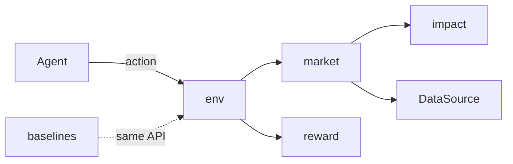

# Architecture Examples

Two projects at opposite ends of the size range, plus short examples of the Extend, Revise, and Grow modes.

---

## Example 1: Single Package — RL Execution Environment (Proof of Concept)

**Context:** The spec describes a reinforcement-learning environment where an agent sells a large stock position over a trading day, trying to beat a simple even-split (TWAP) baseline. Requirements include `ENV-01`–`ENV-05` (reset/step, observations, actions, reward, episode end), `BASE-01` (TWAP baseline agent), `DATA-01`–`DATA-02` (minute bars for price paths), `QR-01` (≥ 10,000 steps/second on a laptop), and `QR-02` (same seed → identical episode).

**Step 1 — Shape:** "Single package. It's a proof of concept with one user, one install, and no separate deployments. I'll keep the data loader behind an interface so it can become its own package if this grows."

**Step 4 — Decisions the skill asked the user about:** standard Gymnasium API vs. a custom one (affects which RL libraries work out of the box), and synthetic vs. historical price paths for the first version.

**Result — `docs/architecture.md`:**

````markdown
# ExecGym — Architecture

**Status:** Draft · **Shape:** Single package · **Last updated:** 2026-10-14 · **Spec:** [spec.md](spec.md)

## Overview
An agent sells a fixed number of shares over one trading day in fixed time steps. Each step, the market module advances the price path and applies the price impact of the agent's sale. The reward is the cost saved versus selling at the arrival price. Price paths come from a `DataSource`: synthetic first, historical minute bars second.



## Tech stack
| Area | Choice | Decision |
|---|---|---|
| Language | Python 3.12 | AD-01 |
| Environment API | Gymnasium ≥ 1.0 | AD-02 |
| Numerics | NumPy ≥ 2.0 | AD-03 |
| Storage | Parquet files via PyArrow | AD-04 |
| Tests | pytest | — |

## Components
| Component | Responsibility | Covers | Depends on |
|---|---|---|---|
| `env` | Gymnasium environment: reset, step, spaces, episode end | ENV-01, ENV-02, ENV-03, ENV-05, QR-02 | `market`, `reward` |
| `market` | Advances the price path one step and fills the agent's order | ENV-03 | `impact`, `data` |
| `impact` | Price impact model (temporary + permanent) | ENV-03 | — |
| `reward` | Implementation-shortfall reward | ENV-04 | — |
| `data` | `DataSource` protocol; synthetic and Parquet implementations | DATA-01, DATA-02 | — |
| `baselines` | TWAP agent using the same API as any RL agent | BASE-01 | `env` |

## Interfaces
See [packages/execgym/contract.md](packages/execgym/contract.md).

## Data
- `SyntheticSource`: geometric Brownian motion with volume curve; used for the first experiments (AD-04).
- `ParquetSource`: one Parquet file per symbol per day with columns `ts, mid, volume`, written by `scripts/download_bars.py` (DATA-01). Days with missing minutes are skipped and logged (DATA-02).

## Cross-cutting concerns
- **Speed (QR-01):** all per-step math is NumPy on preallocated arrays; no pandas inside `step`. Benchmarked in `tests/test_speed.py`.
- **Reproducibility (QR-02):** one `np.random.Generator` per env, created from the `reset` seed and passed down; no global random state.

## Project layout
```
src/execgym/      → env/ market/ impact/ reward/ data/ baselines/ — one folder per component; __init__ exports its contract
scripts/          → bar download script (DATA-01)
tests/
```

## Decisions
### AD-01: Python 3.12
**Status:** Proposed · **Date:** 2026-10-14 · **Scope:** system
- **Context:** RL libraries and the user's existing tooling are Python.
- **Decision:** Python 3.12.
- **Alternatives:** 3.13 — some RL libraries lag on new versions.
- **Consequences:** Pin `requires-python = ">=3.12,<3.13"` until the libraries catch up.

### AD-02: Gymnasium API
**Status:** Proposed · **Date:** 2026-10-14 · **Scope:** system
- **Context:** The agent side is undecided; we want to try off-the-shelf RL libraries without adapters.
- **Decision:** Implement `gymnasium.Env`.
- **Alternatives:** Custom API — simpler, but every RL library needs a wrapper. PettingZoo — multi-agent, not needed.
- **Consequences:** Observation and action spaces must be fixed-shape. Vectorized envs come for free.

### AD-03: Vectorized NumPy simulation, not event-driven
**Status:** Proposed · **Date:** 2026-10-14 · **Scope:** system
- **Context:** QR-01 needs ≥ 10,000 steps/second. Fixed time steps; no order book.
- **Decision:** Each step is array math on a precomputed price path.
- **Alternatives:** Event-driven order-book simulation — realistic, far too slow and out of scope (spec Out of scope: order book).
- **Consequences:** Impact is a formula, not emergent. Fine for a proof of concept; revisit if results depend on it.

### AD-04: Synthetic paths first, historical bars second
**Status:** Proposed · **Date:** 2026-10-14 · **Scope:** data
- **Context:** DATA-01 needs minute bars. A free sample covers a few symbols; full history costs money.
- **Decision:** Ship `SyntheticSource` first and add `ParquetSource` from a free sample. Both behind `DataSource`.
- **Alternatives:** Paid minute data now — premature before the environment proves useful.
- **Consequences:** Early results are on synthetic paths; the brief's success measure needs historical days, so `ParquetSource` must land before evaluation.

## Risks and open questions
- The impact model's parameters are guesses. Agents may learn to exploit the formula. Mitigation: compare against TWAP under two different parameter sets.

## Changelog
| Date | Change | Source | IDs |
|---|---|---|---|
| 2026-10-14 | Initial architecture | spec.md | AD-01–AD-04 |
````

**Result — `docs/packages/execgym/contract.md`:**

````markdown
# execgym — Contract

**Package:** execgym · **Status:** Draft · **Last updated:** 2026-10-14 · **Architecture:** [../../architecture.md](../../architecture.md)

## env

### env.ExecutionEnv: Gymnasium execution environment
```python
class ExecutionEnv(gymnasium.Env):
    def reset(self, *, seed: int | None = None, options: dict | None = None) -> tuple[np.ndarray, dict]: ...
    def step(self, action: np.ndarray) -> tuple[np.ndarray, float, bool, bool, dict]: ...
```
- **Invariants:** observation is `[time_left, inventory_left, price_vs_arrival, recent_volatility]`, float32; action is the fraction of remaining inventory to sell, `Box(0.0, 1.0)`; `terminated` when inventory is zero or the day ends (any remainder is sold at the close); same seed → identical episode
- **Errors:** `ValueError` if the action is outside [0, 1]
- **Used by:** baselines, any RL agent

## data

### data.DataSource: Price path provider
`class DataSource(Protocol): def price_path(self, rng: np.random.Generator) -> PricePath`
- **Invariants:** deterministic for a given `rng` state
- **Errors:** `FileNotFoundError` if a Parquet day is missing (historical source only)
- **Used by:** market

### data.PricePath: One episode's prices
`@dataclass(frozen=True) class PricePath: mid: np.ndarray; volume: np.ndarray`
- **Invariants:** both arrays have one entry per step, same length as the episode; `mid` > 0
- **Used by:** market

## reward

### reward.implementation_shortfall: Cost saved versus arrival price
`def implementation_shortfall(fills: Fills, arrival_price: float) -> float`
- **Invariants:** 0 when every fill is at the arrival price; positive when the agent sold above it
- **Errors:** `ValueError` if `arrival_price` ≤ 0
- **Used by:** env
````

**About two pages plus a one-page contract.** No packages table, no dependency rules section, and no separate package docs. The seam that might become a package later (`DataSource`) is named and nothing more. Each component is a folder exporting only its contract section, so a later split moves `data/` and its `## data` group as they are. `Used by` names components: the pipelines that use each symbol don't exist until `pipeline-design` runs.

---

## Example 2: Multi-Package — Quant Platform (Monorepo)

**Context:** The Factor Lab project has grown. The spec now covers data ingestion on a schedule, a point-in-time store, factor research, backtesting, paper trading, and reporting. Parts run on different schedules (nightly ingestion, interactive research, a long-running paper-trading service), and the team wants research code unable to import trading code.

**Step 1 — Shape:** "Multi-package. Ingestion and paper trading are deployed separately from the research library, and you want `strategies` blocked from importing `execution`, which tooling can enforce between packages. Proposed packages and direction:"

```
reports → backtest → factors → data → core
ingest → data
execution → factors, data
```

The user approves the package map before any package doc is written.

**Result — root `docs/architecture.md` (abridged):**

````markdown
# Factor Lab — Architecture

**Status:** Draft · **Shape:** Multi-package · **Last updated:** 2026-10-14 · **Spec:** [spec.md](spec.md)

## Overview
Nightly, `ingest` pulls prices and fundamentals into a point-in-time store. Researchers use `data`, `factors`, and `backtest` from notebooks. `execution` runs separately, reading signals and placing paper trades. `reports` builds tear-sheets from backtest and live results.

## Packages
| Package | Path | Responsibility | Covers | Depends on | Doc |
|---|---|---|---|---|---|
| `core` | packages/core | Shared types: dates, symbols, calendars, money | QR-03 | — | [core](packages/core/architecture.md) |
| `data` | packages/data | Read-only point-in-time query API | DATA-01–DATA-06 | `core` | [data](packages/data/architecture.md) |
| `ingest` | packages/ingest | Scheduled download, validation, and write to the store | ING-01–ING-04 | `core`, `data` | [ingest](packages/ingest/architecture.md) |
| `factors` | packages/factors | Factor definitions and signal building | FAC-01–FAC-05 | `core`, `data` | [factors](packages/factors/architecture.md) |
| `backtest` | packages/backtest | Vectorized backtests with costs | BT-01–BT-06 | `core`, `data`, `factors` | [backtest](packages/backtest/architecture.md) |
| `execution` | packages/execution | Paper trading service | EXE-01–EXE-04 | `core`, `data`, `factors` | [execution](packages/execution/architecture.md) |
| `reports` | packages/reports | Tear-sheets and comparisons | REP-01–REP-03 | `core`, `backtest` | [reports](packages/reports/architecture.md) |

## Dependency rules
- `core` imports nothing internal.
- Only `ingest` writes to the store; everything else reads through `data`.
- `factors` and `backtest` never import `execution` or `ingest`.
- Enforced by `import-linter` contracts in CI (AD-03).

## Cross-package contracts
- `data.PointInTimeStore` — provided by `data`, used by every package. [Contract](packages/data/contract.md)
- `factors.Signal` (date × symbol → score) — provided by `factors`, used by `backtest` and `execution`. [Contract](packages/factors/contract.md)
- `backtest.Result` (returns, positions, costs) — provided by `backtest`, used by `reports`. [Contract](packages/backtest/contract.md)

## System pipelines
### PL-01: Research backtest
**Trigger:** called from a research notebook · **Covers:** FAC-01–FAC-05, BT-01–BT-06, REP-01
1. `data` → `factors`: `data.PointInTimeStore` (prices and fundamentals as known on each date)
2. `factors` → `backtest`: `factors.Signal`
3. `backtest` → `reports`: `backtest.Result`

### PL-02: Paper trading day
**Trigger:** `execution` service, at each market open · **Covers:** EXE-01–EXE-04
1. `data` → `factors`: `data.PointInTimeStore` (as of the previous close)
2. `factors` → `execution`: `factors.Signal`

*(PL-03, nightly ingest, omitted here.)*

## Project layout
```
packages/core/  packages/data/  packages/ingest/  packages/factors/
packages/backtest/  packages/execution/  packages/reports/
```

## Shared tech stack and tooling
| Area | Choice | Decision |
|---|---|---|
| Workspace | uv workspace, one lockfile | AD-01 |
| Language | Python 3.12 | AD-02 |
| Store | Parquet files + DuckDB queries | AD-04 |
| Market data | Provider B | AD-05 |

Packages are versioned together; one release tag for the repo.

## Decisions
### AD-05: Market data provider
**Status:** Proposed · **Date:** 2026-10-14 · **Scope:** `ingest`, `data`
- **Context:** Checked against DATA-01 (daily prices for all US stocks since 2010, *including delisted*), DATA-03 (fundamentals stamped with the date they became public), and the brief's budget (< $100/month).
- **Decision:** Provider B.
- **Alternatives:** Provider A (free) — fails DATA-01: no delisted companies. Provider C — meets everything but costs about 4× the budget.
- **Consequences:** Ingestion is written against Provider B's API behind `ingest.Source`, so a later switch touches one module.

*(AD-01–AD-04 omitted here.)*

## Changelog
| Date | Change | Source | IDs |
|---|---|---|---|
| 2026-10-14 | Initial architecture | spec.md | AD-01–AD-05 |
````

**Each package** gets a folder. `docs/packages/data/architecture.md` uses the single-package template for that package: its modules, its data layout and its folders, with Interfaces linking to `contract.md` beside it. It carries no Decisions or Changelog; those live in the root. `docs/packages/data/contract.md` holds `### data.PointInTimeStore: …` and the other public symbols, with signatures, invariants and errors. `pipeline-design` later adds each package's `pipelines.md` to the same folder.

**Notice:**
- The data provider decision is checked against specific `DATA-` requirements and the brief's budget. That's how "which API?" gets answered. The spec stayed vendor-neutral, and the decision lives here.
- The dependency rules are enforceable, not aspirational.
- The root doc stays a map. Detail lives in package docs, so each one stays a readable 1-3 pages.
- System pipelines say which package hands what to which, through which contract. The functions and files inside each package are left to `pipelines.md`.

---

## Example 3: Extend, Revise, and Grow (Short)

**Extend.** The `plate-qc-ranking` idea was specced as `QCR-01`–`QCR-05` plus `DATA-07`. `dt status` reports those six as uncovered. The skill reads the idea file for context and runs the Grow check: gradient-boosted trees add one library, nothing runs or deploys on its own, and `grow_triggers` is empty, so no trigger fires and it says so at the gate. It adds a `ranking` component covering QCR-01–QCR-04, with a `### ranking.rank_plates` section in `contract.md`. It adds QCR-05 (the review screen sort order) to the existing `review_ui` component's Covers, and records `AD-09: gradient-boosted trees for plate risk`, checked against the spec's baseline criterion (must beat sorting by Z′). One Changelog row, sourced from `ideas/plate-qc-ranking.md`. Status goes back to Draft.

**Revise.** During the build, ExecGym runs at 3,000 steps/second, failing QR-01. The fix is to move the step loop into Numba. The skill writes `AD-05: JIT-compile the step loop with Numba`, with context "AD-03's NumPy step measured at 3k steps/s; QR-01 needs 10k". AD-03's choice (vectorized, not event-driven) still holds, so AD-05 doesn't supersede it. AD-03's text is still true, so it isn't revised either. Some other text is no longer true, and the skill rewrites it: the Speed line under Cross-cutting concerns said all per-step math is plain NumPy, and now names the compiled loop and AD-05. The tech stack gains Numba. One Changelog row; no spec change.

**Grow.** ExecGym's spec gains a recorder that saves live minute bars every trading day. It's a long-running service deployed on its own, so the Extend round's Grow check fires ("a part runs or deploys on its own"). The skill proposes Grow, and after the user agrees writes `AD-06: split ExecGym into packages`, giving that reason. It proposes three packages:
- `data` — the `DataSource` seam named in the original design, now shared by the recorder and the environment
- `execgym` — env, market, impact, reward, and baselines; depends on `data`
- `recorder` — the new service; depends on `data`, never on `execgym`

Component ids become package ids, so existing Covers entries and contract IDs still resolve. Module detail moves to `docs/packages/<package>/architecture.md`. The `## data` group of the old contract moves to `docs/packages/data/contract.md` with its IDs (`data.DataSource`) unchanged; the rest stays in `docs/packages/execgym/contract.md`. In the code, `src/execgym/data/` moves out as a folder. The root becomes the system map, with a System pipeline `PL-NN: Record a trading day` (a new ID from `dt next-id PL`; `recorder` → `data`: `data.write_bars`, a new contract section), and the shape changes to `Multi-package`. No existing pipeline crosses the new boundary. Had one, it would keep its own ID as its owning package's segment, and `pipeline-design` Grow would mark it `**Part of:**` the new system pipeline. The seam named in the proof of concept is exactly where the split happens. After approval the skill points to `pipeline-design` Grow.
